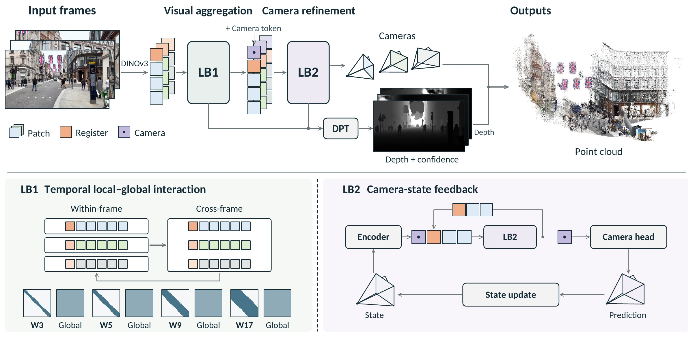

  

<h1 align="center">LoFT</h1>
<h3 align="center">Looped Foundation Transformer for Video Geometry</h3>

  <a href="https://horizonrobotics.github.io/robot_lab/loft/">Project Page</a>
  &nbsp;·&nbsp;
  <a href="https://horizonrobotics.github.io/robot_lab/loft/#method">Method</a>
  &nbsp;·&nbsp;
  <a href="https://horizonrobotics.github.io/robot_lab/loft/#results">Results</a>

<strong>Code coming soon.</strong>

## Overview

**LoFT** reconstructs 3D scenes from RGB video by combining temporal attention with iterative camera refinement. It estimates camera poses, field of view, and per-frame depth and confidence, supporting 3D reconstruction from continuous video.

LoFT uses two loops: one aggregates visual features across frames, and the other refines camera predictions by feeding the updated camera state back into the model. Each loop shares its own weights across iterations, so a single model can run at different refinement depths.

### Highlights

- **Video continuity:** progressively wider temporal attention windows alternate with attention over the full clip, connecting nearby frames and distant views of the same scene.
- **Explicit camera feedback:** each refinement step uses the updated camera state to guide the next feature update.
- **Shared weights across iterations:** the number of refinement steps can vary without changing the model's parameters.
- **Broad training data:** training spans 80 public datasets, with evaluation on SpatialBench, ClassicBench, and VRBench.

## Method

## Release status

| Resource | Status |
| :--- | :--- |
| [Project page](https://horizonrobotics.github.io/robot_lab/loft/) | Available |
| Source code | Coming soon |
| Paper | Coming soon |
| Hugging Face release | Coming soon |

Watch this repository for the code release. Installation and usage instructions will be added with the release, and citation information will be added when the paper is published.
