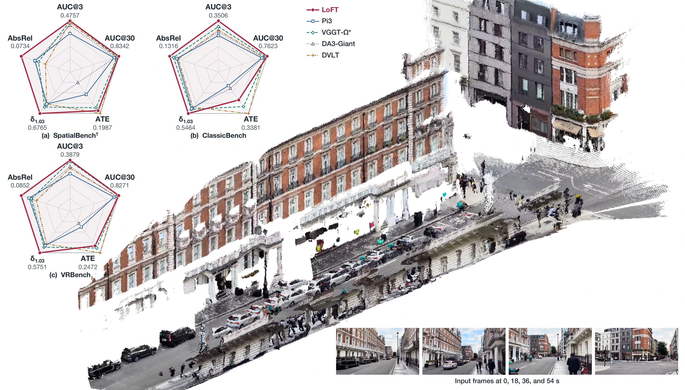

# *LoFT*: Looped Foundation Transformer for Video Geometry

-lightgrey)
-lightgrey)

> **3D reconstruction from RGB video.**
> LoFT predicts camera poses, field of view, depth, and confidence through temporal attention and iterative camera refinement.
>
> 🚧 **Code coming soon.**

*SpatialBench† denotes the continuous-video subset; VGGT-Ω&#42; denotes the officially retrained model.*

---

## 🧠 Method

---

## 🚀 Release

Watch this repository for release updates. Usage instructions and citation information will follow.
